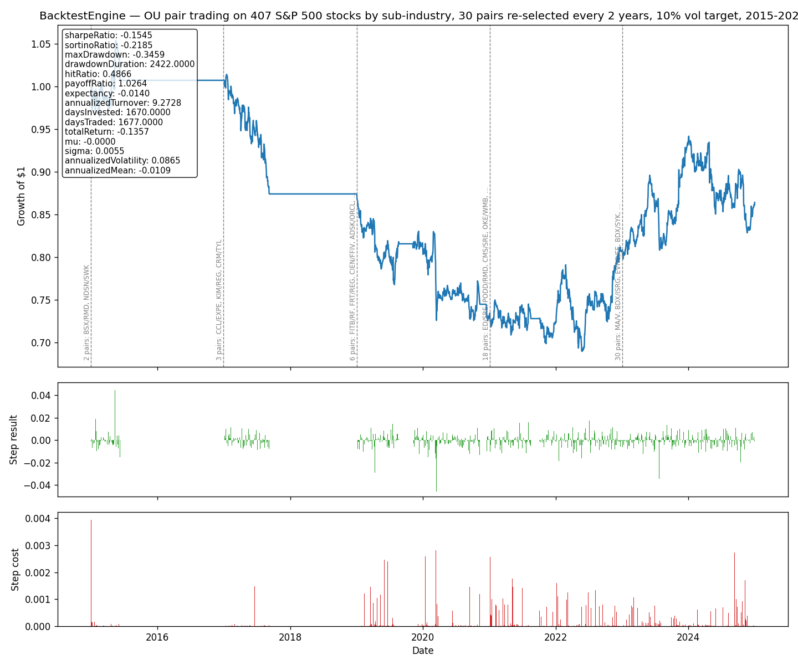

# Backtest

[](https://github.com/Lucas-Zivkovic/Backtest/actions/workflows/tests.yml)

[](LICENSE)

An event-driven backtesting engine for equity long/short strategies, with realistic transaction costs, square-root market impact, and a performance/metrics layer. It is used to research momentum, single-stock mean reversion, and pair trading on US large caps, including the S&P 500 grouped by sub-industry.

The point is not only to get a good Sharpe ratio, but to know whether a result is real or comes from a bias, a bug, or chance. The main finding is negative and explained: once look-ahead, data and cost issues are fixed, classic pair trading on the S&P 500 shows no reliable edge since 2015 (see [Findings](#findings-so-far)).



## Quick start

```bash
git clone https://github.com/Lucas-Zivkovic/Backtest.git
cd Backtest
uv sync                                                  # install dependencies
uv run pytest test_backtest_engine.py test_data_loaders.py -m "not realdata"  # fast unit tests, no network
uv run pytest test_backtest_engine.py -k famaFrench -s   # downloads Fama-French factors, regresses AAPL
```

A minimal backtest (12-1 momentum on 12 mega-caps, about 10 s). The engine takes any data source with an `iterate(start, end)` method:

```python
import numpy as np

import DataLoader
from BacktestEngine import BacktestEngine
from Strategies.CrossSectionalMomentumStrategy import CrossSectionalMomentumStrategy


class InMemoryDataSource:
    """Yields (date, OHLCV history up to date), one date at a time."""

    def __init__(self, prices):
        self.prices = prices

    def iterate(self, start, end):
        mask = (self.prices.index >= start) & (self.prices.index <= end)
        for i in np.where(mask)[0]:
            yield self.prices.index[i], self.prices.iloc[: i + 1]


tickers = ["AAPL", "MSFT", "AMZN", "GOOGL", "META", "NVDA", "JPM", "XOM", "JNJ", "PG", "V", "UNH"]
ohlcv = DataLoader.getOHLCV("2015-01-01", "2025-01-01", tickers, "1d").dropna()
strategy = CrossSectionalMomentumStrategy(skipMonths=1, lookbackMonth=12)
engine = BacktestEngine(strategy, InMemoryDataSource(ohlcv))
engine.run("2017-01-01", "2025-01-01")
print(engine.metrics)
```

## Project layout

```
BacktestEngine.py        Event loop: steps through dates, asks the strategy for target weights, books P&L and costs
DataLoader.py            Downloads and caches OHLCV data (Yahoo Finance, Kraken, Interactive Brokers), S&P 500 constituents (Wikipedia), Fama-French factors
Transaction.py           Cost models: percentage fee, half-spread, square-root market impact
PositionSizing.py        Turns signals into weights (dollar-neutral, signed, inverse-vol, Kelly, risk contribution...)
PerformanceAnalyzer.py   Turns per-step returns and positions into a metrics table
Metrics.py               Sharpe, Sortino, drawdown, hit/payoff ratio, expectancy, turnover, days invested/traded
OrnestUhlenbeck.py       Ornstein-Uhlenbeck calibration (method of moments, then maximum likelihood)
strategies.py            Signal helpers (momentum, log returns, HMM regimes, Fama-French regression)

Strategies/
  Strategy.py                        Base class: implement signal(); positions() defaults to dollar-neutral
  Momentum.py                        12-1 trailing momentum (Jegadeesh-Titman)
  CrossSectionalMomentumStrategy.py  Long the top decile / short the bottom decile by momentum
  MeanReversion.py                   Per-ticker OU fit on log prices, trades its z-score
  PairFinding.py                     Candidate groups (DBSCAN clusters or sub-industries) and Johansen cointegration tests
  PairTrading.py                     Trades the z-score of stable cointegrated spreads, pairs re-selected on a schedule
  ZScorePositions.py                 Entry / exit / stop-loss rules shared by MeanReversion and PairTrading
  VolatilityTarget.py                Wrapper scaling any strategy to a target expected volatility
  PortfolioCombiner/
    PortfolioCombiner.py             Base class for blending several strategies
    Uniform.py                       Equal weights
    CalibratedCombiner.py            Weights estimated on a calibration window that ends before the backtest
    InvVol.py                        Weights proportional to 1 / volatility
    RiskParity.py                    Equal risk contribution, using the full covariance matrix

test_backtest_engine.py  Unit tests and end-to-end research runs on real data
test_data_loaders.py     Yahoo / Kraken / IBKR loaders: faked APIs, plus real-data checks
plots/                   Charts written by the research runs
docs/RESUME_PROJET.txt   Project summary in French: approach, problems found, results
```

## How the engine works

1. A data source exposes `iterate(start_date, end_date)` and yields `(date, market_data)`, where `market_data` is the OHLCV history up to and including `date`.
2. At each date `t`, the engine gives the strategy the close prices **up to `t-1`** and asks for target weights. The strategy never sees the price it is scored on.
3. The day's P&L is `sum(weights * close-to-close return on t) - cost`.
4. The cost of moving from yesterday's weights to today's is, as a fraction of the portfolio:
   - fee: `turnover * transactionCostRate` (default 0.05%)
   - half-spread: `sum(|Δw|) * spread / 2` (default spread 0.05%)
   - square-root impact: `sum(|Δw_i| * σ_i * sqrt(shares_i / avgVolume_i))`, for a $1M portfolio by default
5. Signals, positions, costs and returns are recorded at every step, and `engine.metrics` holds the summary.

A `Strategy` only implements `signal(prices)`. Its result is either a per-ticker score, or a `(ticker, field)` table that also keeps everything the strategy computed (fitted parameters, z-scores, p-values, ...), so every decision can be inspected afterwards. `positions()` sizes on the `score` field. `cachedSignal()` computes the signal once per step, even when a combiner asks for it several times.

## Strategies

**Momentum.** 12-1 momentum, cross-sectional: long the top decile, short the bottom decile, equal weight, dollar-neutral.

**Mean reversion (single stock).** Each day an OU process is fitted on the last `window` log prices of each ticker. Positions follow the `ZScorePositions` rules:
- **Entry:** when 1.5 < |z| < 3, only if the ADF p-value is below 0.01 and the OU half-life is below `window / 2`.
- **During the trade:** z is measured against the mean and std frozen at entry, so a drifting mean cannot fake a reversion or dodge the stop.
- **Exit:** when |z| < 0.5, or stop out past |z| = 3. After a stop, no re-entry until |z| < 0.5.
- **Sizing:** inverse volatility, so a ticker without a trade leaves its share in cash.

**Pair trading.**
1. **Candidates:** pairs within the same group, either a DBSCAN cluster on return correlations or, for the S&P 500, the GICS sub-industry.
2. **Selection:** Johansen trace test on log prices, which does not depend on the order of the two legs. A pair is *stable* only if it is cointegrated over the whole formation period **and** over each half, with a positive hedge ratio. This removes most pairs that pass by chance.
3. **Formation:** the hedge ratio comes from the Johansen vector. The spread's OU mean, std and half-life are fitted once on the formation period, not on a short rolling window, which cannot estimate a spread with a half-life of months.
4. **Trading:** same `ZScorePositions` rules. Each pair gets 1 / `numberPair` of the book, split 1 : β between its legs.
5. **Re-selection:** every `refitDays` (default 2 years) on the previous `formationDays` (default 5 years), from the history the engine passes, so no formation sees the future. If no pair is stable, the strategy stays in cash.

**Volatility target.** `VolatilityTarget(strategy, targetVol=0.10)` scales any strategy so the ex-ante volatility of its current book, from the last 60 days of return covariances, matches the target. Gross exposure is capped at `maxGross` (default 4).

**Combiners.** Blend several strategies with `Uniform`, `InvVol` or `RiskParity` weights. The calibrated combiners estimate their weights on a window that ends before the backtest, and refuse to trade inside it.

## Data

- **Prices:** `DataLoader.getOHLCV(start, end, tickers, "1d")` downloads from Yahoo Finance and caches one CSV per request. Open/High/Low/Close are adjusted for dividends by default (`adjusted=True`), so ex-dividend days are not price drops; Volume is left as traded.
- **Cache location:** downloads are cached in `data/` (git-ignored, created on first use). Set `QUANT_DATA_PATH` to use another folder. Long ticker lists get a hashed file name.
- **S&P 500:** `DataLoader.getSP500Constituents()` downloads the current members with their GICS sector and sub-industry from Wikipedia, once.
- **Fama-French:** `DataLoader.getFamaFrenchData(start, end)` gives the daily 5 factors plus momentum, in percent, from Kenneth French's data library. `strategies.famaFrenchRegression(ticker, start, end)` regresses one stock's excess returns on them.

**Survivorship bias:** the S&P 500 list is today's members, so companies that left the index or went bankrupt are missing. The S&P 500 test also requires a full price history and more than $5M of median daily trading volume *before* the backtest starts.

## Setup

This project uses [uv](https://github.com/astral-sh/uv) (Python >= 3.9).

```bash
uv sync
```

## Tests

`test_backtest_engine.py` and `test_data_loaders.py` contain two kinds of tests:

- **Unit tests**, fast and without network: trade rules, state carried between steps, risk parity, recovery of known Fama-French loadings on synthetic data, and each data loader against a faked API (parsing, adjustment, date filtering, caching). They run on every push (GitHub Actions).
  ```bash
  uv run pytest test_backtest_engine.py test_data_loaders.py -m "not realdata" -v
  ```
- **Research runs** on real data, marked `realdata`. They download and cache prices on first use, write a chart to `plots/`, and check the accounting: each day's return equals positions × returns − costs, costs ≥ 0, gross exposure stays within its limit, and nothing traded uses data from after the trade date.
  ```bash
  uv run pytest test_backtest_engine.py -k pairFinding -s          # clusters and cointegration
  uv run pytest test_backtest_engine.py -k "real_data_pairTrading" -s
  uv run pytest test_backtest_engine.py -k sp500 -s                # ~5 min: S&P 500, 2015-2024
  uv run pytest test_backtest_engine.py -k meanReversion -s        # slow: one OU fit per ticker per day
  uv run pytest test_backtest_engine.py -k famaFrench -s           # factor data and AAPL factor loadings
  uv run pytest test_data_loaders.py -m realdata -v                # real prices from each loader (IBKR needs TWS)
  ```
  Add `-s` to see the printed tables (formations, metrics).

## Findings so far

| Strategy | Result | Why |
|---|---|---|
| Single-stock OU mean reversion, 12 mega-caps | No edge; Sharpe ≈ −1.1 on 2015-2022 (run before the cost-model fix, to re-run) | Single stock prices are rarely stationary. Buying dips on trending mega-caps bets against momentum. |
| Pair trading, 35 large caps | No stable pair at any formation | The best pairs are cointegrated over one half of the formation period but not the other: chance, not a relationship. |
| Pair trading, 407 S&P 500 stocks by sub-industry, 30-50 pairs, 10% vol target, 2015-2024 | −14%, Sharpe −0.16, max drawdown −35% | Few stable pairs before 2019 (2-6), so the book is concentrated. Daily resizing by the vol target creates ~9× annual turnover. Results depend on the re-formation dates. |

Pair trading on S&P 500 stocks shows no reliable edge net of costs since 2015, which matches the literature on its decline since the 2000s. Momentum and the combiners have not been re-run since the cost-model fix and the dividend adjustment.

## Known limitations

- **Same-close execution:** trades are decided and executed on the same close (t−1). Trading at the next open would be more conservative, especially for mean reversion.
- **Small look-ahead in costs:** the impact model's average volume includes the current day.
- **No financing:** cash earns no interest, even though the Sharpe ratio subtracts a 0.25% risk-free rate. There is no cost for borrowing to short or for leverage.
- **No significance testing:** there is no t-stat, bootstrap or deflated Sharpe ratio, and no untouched holdout period. Many variants were tried on the same data.
- **Slow on long histories:** the engine recomputes volatility and average volume over the whole history at every step.
